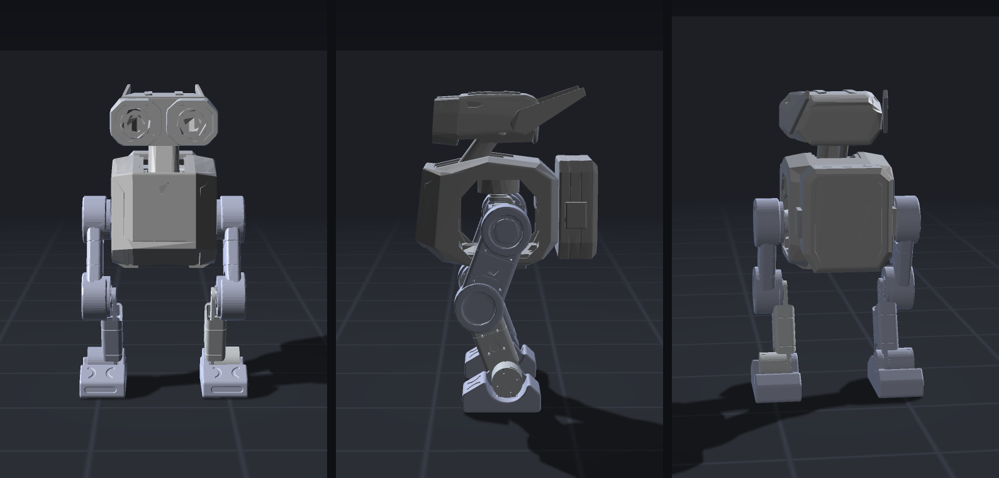

# kudada_rl_unilab

Kudada (Nano1) 10-DoF 双足机器人平地速度跟踪训练仓库，基于
[UniLab](https://github.com/Motphys/UniLab) 的外部任务接入机制构建。



外形以这张多视角图为准。四个已验收步态的一次同屏演示（左上 WalkFlat、右上 CrouchWalk、左下 LateralWalk、右下 MarchRecover；8 秒同步回放）：

<video src="renders/kudada_gaits_2x2.mp4" width="100%" controls muted playsinline></video>

[四步态 2×2 同屏演示 `kudada_gaits_2x2.mp4`](renders/kudada_gaits_2x2.mp4)

本仓库不复制 UniLab 的 runner/learner/collector：

- `UNILAB_EXTRA_REGISTRY_PACKAGES` 注入 `KudadaWalkFlat` 等环境注册；
- Hydra `--config-dir` 注入 `task=<gait>/mujoco` owner 配置；
- `unilab` 的 `sac` 入口运行 FastSAC 双缓冲异步训练；
- 物理后端固定为 MuJoCo。

CLI：`kudada-train` / `kudada-eval` / `kudada-continue`。`--task` 取值为
`walk-flat`、`crouch-walk`、`lateral-walk`、`march-recover`。

## 资产

两套模型都随仓库保存：

- `assets/robots/kudada/urdf/`：原始 SolidWorks URDF 与 11 个 STL；
- `assets/robots/kudada/mjcf/`：修正后的 MuJoCo MJCF、平地 scene 与 STL。

MJCF 显式保留了 URDF 的质量/惯量、10 个关节限位，并补齐：

- 基座 free joint 和 IMU site；
- 双脚 position/orientation site；
- `kp=40, kv=2` 的位置执行器及 12/20 Nm 力矩限制；
- 默认蹲姿 `home` keyframe；
- 足底与膝盖碰撞几何。

已验收策略在 `gaits/<task>/`（每个步态只入库当前一份 `model_10000.pt`）。
目录约定见 [`gaits/README.md`](gaits/README.md)。与 MotrixLab/`tinkerbot_rl`
的吞吐/延迟/精度对比见 [`docs/COMPARISON.md`](docs/COMPARISON.md)。

## 安装

针对 **Linux x86_64 + AMD ROCm**。PyTorch 锁在 **2.11.0 + ROCm 7.2** 轮子
（`pyproject.toml` 里的 `pytorch-rocm72` index）。没有 CUDA extra，NVIDIA
机器不能按下面这条装。需要 [uv](https://docs.astral.sh/uv/)、Python 3.10–3.13、
一块可被 `HIP_VISIBLE_DEVICES` 看到的 GPU。当前验收环境是 MI210。

无显示录视频还需要能用的 OSMesa（设 `MUJOCO_GL=osmesa`）。`pytest` 在 uv 的
`dev` group 里，`uv sync` 默认会装。

```bash
git clone git@github.com:alexhegit/kudada_rl_unilab.git
cd kudada_rl_unilab
uv sync --extra rocm
```

若 venv 是从别的目录拷来的（shebang 仍指向旧路径），删掉 `.venv` 再
`uv venv --python 3.10 .venv && uv sync --extra rocm --frozen`。

## 训练

默认配方：2048 env、10000 iter、batch 2048、每步 4 次更新、bf16 AMP、
每 1000 iter 写一次 `model_*.pt`。日志和 checkpoint 在 gitignore 的
`runs/<任务名>/<时间戳>_mujoco/`，例如 `runs/KudadaWalkFlat/2026-09-18_17-59-22_mujoco/`。

单卡训一个步态（把 `--task` 换成另外三个名字即可）：

```bash
export HIP_VISIBLE_DEVICES=0
uv run --extra rocm kudada-train --algo sac --task walk-flat --sim mujoco
```

四卡并行（GPU 0–3，seed 分别为 crouch=1、lateral=2、march=3、walk-flat=4）：

```bash
bash scripts/train_gaits_parallel.sh
```

短程冒烟：

```bash
export HIP_VISIBLE_DEVICES=0
uv run --extra rocm kudada-train --algo sac --task walk-flat --sim mujoco \
  algo.num_envs=4 algo.max_iterations=2 training.no_play=true training.play_env_num=4
```

从归档策略续训（默认 `--load-run` 已是 `gaits/walk-flat`）：

```bash
export HIP_VISIBLE_DEVICES=0
uv run --extra rocm kudada-continue --algo sac --task walk-flat --sim mujoco \
  --load-run gaits/walk-flat \
  algo.max_iterations=10000 training.log_root=runs
```

## 评估归档策略

仓库里可复现的是 `gaits/<task>/model_10000.pt`，不要用 `--load-run -1`
（那是最近一次 `runs/`，本机才有）。无显示机器加上 `MUJOCO_GL=osmesa`。

```bash
export HIP_VISIBLE_DEVICES=0 MUJOCO_GL=osmesa
uv run --extra rocm kudada-eval --algo sac --task walk-flat --sim mujoco \
  --load-run gaits/walk-flat
```

其它步态同样改 `--task` 和 `--load-run gaits/<task>`。回放最近一次本地训练才用
`--load-run -1`。

UniLab 自带播放器在无 GL 时容易失败；要导出 mp4 用下一节的 OSMesa 脚本。

## 录视频（OSMesa）

`scripts/record_gait_video.py` 先 rollout 再离线渲染。默认输出是 run 目录下的
`play_video.mp4`（不是归档文件名 `play.mp4`）。覆盖归档视频时显式设
`KUDADA_VIDEO`。

```bash
export HIP_VISIBLE_DEVICES=0 MUJOCO_GL=osmesa

KUDADA_RUN_DIR=gaits/walk-flat KUDADA_TASK=walk-flat \
  KUDADA_VIDEO=gaits/walk-flat/play.mp4 \
  uv run --extra rocm python scripts/record_gait_video.py

KUDADA_RUN_DIR=gaits/crouch-walk KUDADA_TASK=crouch-walk \
  KUDADA_VX=0.35 KUDADA_HEIGHT=0.20 \
  KUDADA_VIDEO=gaits/crouch-walk/play.mp4 \
  uv run --extra rocm python scripts/record_gait_video.py

KUDADA_RUN_DIR=gaits/lateral-walk KUDADA_TASK=lateral-walk \
  KUDADA_VY=0.3 \
  KUDADA_VIDEO=gaits/lateral-walk/play.mp4 \
  uv run --extra rocm python scripts/record_gait_video.py

KUDADA_RUN_DIR=gaits/march-recover KUDADA_TASK=march-recover \
  KUDADA_PUSH_STEP=150 KUDADA_PUSH_Y=0.6 \
  KUDADA_VIDEO=gaits/march-recover/play.mp4 \
  uv run --extra rocm python scripts/record_gait_video.py
```

## 验收入库

每个步态只保留当前验收的一份权重，覆盖 `gaits/<task>/`，不要并列
`model_v7.pt`。从对应 `runs/<TaskName>/<stamp>_mujoco/` 拷贝：

- `model_10000.pt`、`run_config.json`、`run_summary.json`
- 把 `src/kudada_rl_unilab/conf/sac/task/<task>/mujoco.yaml` 存成 `task.yaml`
  （walk-flat 另把 `base.yaml` 存成 `task_base.yaml`）
- 用上一节命令写出 `play.mp4`

`.gitignore` 只允许 `gaits/<task>/model_10000.pt` 入库，其它 `gaits/**/*.pt` 进不了 `git add`。

## 其它步态

| 任务 | UniLab 任务名 | 说明 |
| --- | --- | --- |
| `walk-flat` | `KudadaWalkFlat` | 平地跟踪 `[vx, vy, yaw]` |
| `crouch-walk` | `KudadaCrouchWalk` | 屈膝低重心行走（不是劈腿） |
| `lateral-walk` | `KudadaLateralWalk` | 侧向平移，限制 `vx` / yaw |
| `march-recover` | `KudadaMarchRecover` | 原地高抬腿，训练中随机推 |

`crouch-walk` 的低重心必须来自屈膝而非劈腿：只奖励基座高度时策略会外展髋关节把腿
劈开来降低重心，所以配置里同时约束了关节目标（`penalty_crouch_pose`）和横向脚距
（`penalty_wide_feet`），并把动作缩放放大到 0.8 以让膝关节能够到达蹲姿目标。

## 测试

```bash
uv run --extra rocm pytest -q
```

默认跳过 `slow` 标记。任务目标与原 MotrixLab 版保持一致：跟踪
`[vx, vy, yaw_rate]` 指令，包含站立指令、左右脚相位、姿态与动作平滑奖励，以及
逐步增加惩罚权重的课程学习。仿真后端从 MotrixSim 换成了 MuJoCo，训练结果不保证
逐轨迹数值一致。
